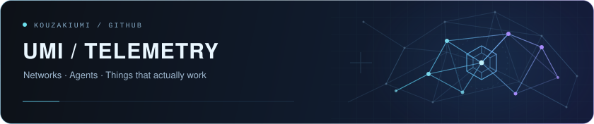

# Kouzaki Umi/神前 海

Network engineer, hobbyist developer, and unapologetic vibe coder.

I’m not a professional software engineer. 

Most of my software projects start with a problem I actually have, 

followed by some variation of:

> “This is annoying. I can probably make AI build a tool for it.”

I use AI heavily for implementation, while I focus more on 

requirements, architecture, debugging, testing, validation, 

and figuring out why something exploded at 3 AM.

### What I usually work on

- 🌐 Networking and systems
- 🤖 AI tooling, agents, and model integrations
- 🛠️ Python / TypeScript utilities
- 🎮 Game localization and modding
- 🔍 Debugging weird edge cases
- 🧪 Vibe coding things that probably did not need to become full projects

### How I build things

A lot of my code is AI-assisted / vibe-coded.

That does **not** mean “prompt once and ship whatever comes out.”  

My usual workflow is closer to:

**problem → requirements → AI implementation → testing → debugging → 

review → more testing → somehow a real project exists**

I care more about whether a tool is understandable, testable, recoverable, 

and actually useful than whether I personally typed every line of it.

---

Mostly here to build tools for my own problems, 

break things in interesting ways, and occasionally fix them.

<!-- UMI-TELEMETRY:START -->

  
  

Public GitHub activity · Automatically refreshed, with caching. Language mix reflects repository code size, not proficiency.

<!-- UMI-TELEMETRY:END -->
